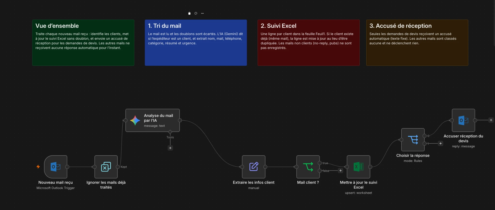

# Assistant traitement mail — menuiserie

Un workflow **n8n** qui trie automatiquement les mails reçus par une menuiserie, tient à jour le suivi clients dans Excel, et répond tout seul aux demandes de devis. Le projet inclut aussi les **skills Claude** utilisés pour le construire.

> 🎬 **Vidéo de démonstration** : *à venir*

---

## Ce que fait le workflow

| Étape | Ce qui se passe |
|---|---|
| 📥 **Réception** | Chaque nouveau mail de la boîte pro est lu. |
| 🧹 **Tri** | Les mails déjà traités sont écartés. L'IA (Gemini) identifie si l'expéditeur est un client, et extrait nom, mail, téléphone, catégorie, résumé et urgence. |
| 📊 **Suivi** | Une ligne par client dans Excel. Si le client existe déjà, sa ligne est mise à jour, sans doublon. |
| ✉️ **Accusé** | Seules les **demandes de devis** reçoivent un accusé de réception automatique. Les autres mails ne déclenchent aucune réponse. |

Le détail de chaque étape est dans [`workflow/README.md`](workflow/README.md).

---

## Le workflow en un coup d'œil



---

## Structure du dépôt

```
.
├── README.md              ← ce fichier
├── workflow/
│   ├── README.md          ← explication détaillée du workflow
│   ├── images/
│   └── FINAL WORKFLOW AVEC NOTES.workflow.ts
├── skills/
│   ├── README.md          ← présentation des skills
│   ├── interview/SKILL.md
│   ├── doubt-driven-dev/SKILL.md
│   └── hostile-review/SKILL.md
└── video/
    └── README.md          ← démonstration (à venir)
```

---

## Les skills Claude

Trois skills ont servi à concevoir et fiabiliser le projet :

- **`interview`** — poser les bonnes questions avant de coder, une par une.
- **`doubt-driven-dev`** — vérifier chaque hypothèse par une preuve avant d'agir.
- **`hostile-review`** — relire le travail comme un relecteur impitoyable, pour trouver ce qui casse.

Détails dans [`skills/README.md`](skills/README.md).

---

## Mise en route

1. **Excel** : dans la feuille `Feuil1`, ajouter les colonnes `REPONSE AUTO`, `ID MAIL`, `RELANCE` et `AVIS`. Créer une feuille `Pièces jointes`.
2. **n8n** : importer le workflow, puis configurer les credentials Microsoft Outlook, Microsoft Excel et Google Gemini.
3. **Test** : lancer une exécution manuelle avec un mail de test *avant* d'activer le workflow.
4. **Activation** : une fois le test concluant, activer le workflow.

> ⚠️ **Confidentialité** — le workflow contient des identifiants internes (ID de credentials, ID de classeur Excel). Aucun mot de passe ni clé d'API n'est présent dans ce dépôt, mais garde-le en lecture seule et ne publie pas de données clients.

---

## Ligne de commande

Le projet se gère avec [`n8ncli`](https://www.npmjs.com/package/@workflows-accelerator/n8n-cli) :

```bash
n8ncli status                          # fichiers modifiés localement
n8ncli diff "<fichier>"                # comparaison avec n8n
n8ncli validate --lint "<fichier>"     # vérification de la structure
n8ncli push --dry-run "<fichier>"      # simulation d'envoi, sans rien modifier
```

---

## Feuille de route

- [ ] Ajouter la vidéo de démonstration (`video/`)
- [ ] Ajouter la relance automatique des devis sans réponse
- [ ] Ajouter l'alerte pour les devis non traités après 24 h
- [ ] Ajouter la demande d'avis Google après facturation
- [ ] Enregistrer les pièces jointes dans OneDrive, par client

---

*Projet réalisé avec [Claude Code](https://claude.com/claude-code).*
